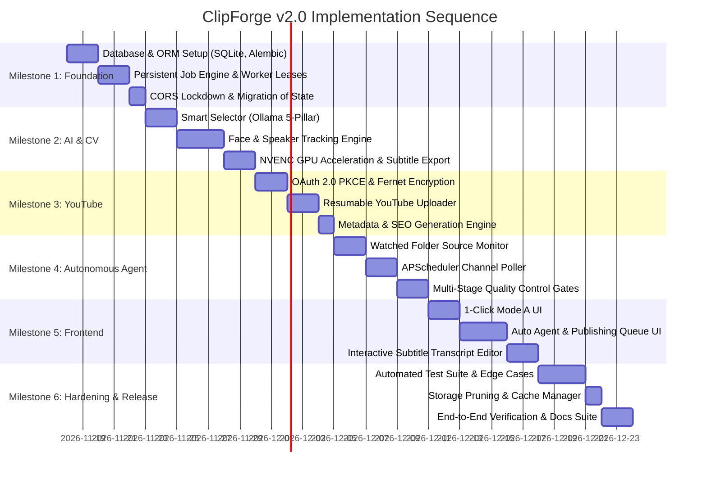

# ClipForge v2.0 — Implementation Plan & Architectural Blueprint

**Project:** ClipForge  
**Version Target:** v2.0.0-stable  
**Baseline Version:** v1.0.0-beta (Build 1)  
**Date:** November 2026  
**Status:** Approved Architectural Specification  

---

## Table of Contents
1. [Executive Summary & Architectural Vision](#1-executive-summary--architectural-vision)
2. [Verified Codebase Inventory & Current Architecture](#2-verified-codebase-inventory--current-architecture)
3. [Existing Functionality vs. Gaps Analysis](#3-existing-functionality-vs-gaps-analysis)
4. [Critical Technical Debt, Security & Performance Audit](#4-critical-technical-debt-security--performance-audit)
5. [Core Architectural Upgrades](#5-core-architectural-upgrades)
6. [Twelve Implementation Phases](#6-twelve-implementation-phases)
   - [Phase 1: Database & Persistent Job Engine](#phase-1-database--persistent-job-engine)
   - [Phase 2: Intelligent Clip Selection (AI Virality Engine)](#phase-2-intelligent-clip-selection-ai-virality-engine)
   - [Phase 3: Video Reframing & Computer Vision (Smart Framing)](#phase-3-video-reframing--computer-vision-smart-framing)
   - [Phase 4: Subtitle & Rendering Engine Improvements](#phase-4-subtitle--rendering-engine-improvements)
   - [Phase 5: YouTube API Integration & Secure OAuth 2.0](#phase-5-youtube-api-integration--secure-oauth-20)
   - [Phase 6: Autonomous YouTube Agent & Scheduled Pipeline](#phase-6-autonomous-youtube-agent--scheduled-pipeline)
   - [Phase 7: Metadata Generation, SEO & Virality Optimization](#phase-7-metadata-generation-seo--virality-optimization)
   - [Phase 8: Output Validation, Quality Gates & Compliance](#phase-8-output-validation-quality-gates--compliance)
   - [Phase 9: React Frontend Modernization & Studio Interface](#phase-9-react-frontend-modernization--studio-interface)
   - [Phase 10: Security Hardening & Zero-Trust Governance](#phase-10-security-hardening--zero-trust-governance)
   - [Phase 11: Storage Lifecycle & Automated Disk Management](#phase-11-storage-lifecycle--automated-disk-management)
   - [Phase 12: Comprehensive Automated Testing & Verification](#phase-12-comprehensive-automated-testing--verification)
7. [Six-Milestone Execution Roadmap](#7-six-milestone-execution-roadmap)
8. [Database Schema Specifications & Migrations](#8-database-schema-specifications--migrations)
9. [YouTube API Policy & Media Acquisition Compliance Architecture](#9-youtube-api-policy--media-acquisition-compliance-architecture)
10. [Hardware, Environment & Dependency Matrix](#10-hardware-environment--dependency-matrix)
11. [Risk Management & Mitigation Matrix](#11-risk-management--mitigation-matrix)

---

## 1. Executive Summary & Architectural Vision

ClipForge v1.0.0-beta demonstrated a robust local multimedia pipeline: downloading YouTube sources via `yt-dlp`, local word-level speech-to-text using `faster-whisper`, ASS subtitle generation with creator presets, and FFmpeg filtergraph rendering with audio ducking and manual keyframe reframing.

**ClipForge v2.0** expands this foundation into a dual-mode autonomous video intelligence and publishing platform:

```
                                  ┌───────────────────────────────┐
                                  │       ClipForge v2.0 Core     │
                                  └──────────────┬────────────────┘
                                                 │
                   ┌─────────────────────────────┴─────────────────────────────┐
                   ▼                                                           ▼
    ┌─────────────────────────────┐                             ┌─────────────────────────────┐
    │           MODE A            │                             │           MODE B            │
    │     One-Click AI Clipper    │                             │  Fully Autonomous YT Agent  │
    ├─────────────────────────────┤                             ├─────────────────────────────┤
    │ • Paste single video / URL  │                             │ • Continuous Channel Watch  │
    │ • Auto-Hook Discovery (LLM) │                             │ • Local Watched Folder Sync │
    │ • Computer Vision Framing   │                             │ • Multi-Stage Quality Gates │
    │ • 1-Click Multi-Clip Export │                             │ • Scheduled Draft/Publish   │
    │ • Human-in-the-Loop Review  │                             │ • Token-Encrypted OAuth 2.0 │
    └─────────────────────────────┘                             └─────────────────────────────┘
```

### Guiding Architectural Principles
1. **Zero Degradation:** Preserve the entire 7-step wizard for power users who want manual control over captions, fonts, music, and keyframes.
2. **Local-First AI:** All transcription (`faster-whisper`), clip ranking (`Ollama`), and face tracking (`OpenCV/MediaPipe`) execute locally without recurring API charges.
3. **Fail-Closed Publishing:** Unattended uploads default to `private` or require explicit queue approval. Direct public uploads require authenticated user opt-in.
4. **Platform Compliance:** Strictly adhere to YouTube API Developer Policies. Never scrape or download restricted YouTube media via unapproved methods. Sources for Mode B are monitored via YouTube Data API v3 and resolved via authorized local files or watched storage folders.
5. **Durable Concurrency:** Replace in-memory states with an ACID-compliant SQLite datastore, transactional worker leases, and idempotent job execution.

---

## 2. Verified Codebase Inventory & Current Architecture

### 2.1 Backend Structure (`app/` — 20 files, ~5,074 LOC)
- `main.py` (538 lines): FastAPI initialization, static file mounts, SSE event endpoints, system telemetry.
- `transcriber.py` (519 lines): CTranslate2 `faster-whisper` integration, dynamic VRAM/RAM hardware auto-scaling, thread-safe model caching.
- `captions.py` (568 lines): Advanced SubStation Alpha (`.ass`) rendering engine, 15+ creator presets (Hormozi, Beast, etc.), word-level karaoke tags.
- `clipper.py` (488 lines): FFmpeg complex filtergraph compiler (scale, crop, rounded corners, sidechain compression ducking).
- `selector.py` (457 lines): Heuristic window scoring (word density, speech rate, hook words, silence boundaries) + experimental Ollama HTTP hook.
- `jobs.py` (437 lines): Thread-based background job dispatcher and in-memory registry.
- `models.py` (407 lines): Pydantic request/response schemas, aspect ratios, fit modes, style overrides.
- `fonts.py` (288 lines): Automatic font fetching and local caching (Google Fonts, Noto fonts for multilingual typography).
- `downloader.py` (203 lines): `yt-dlp` wrapper with progressive fallback strategies and cookie detection.
- `effects.py` (200 lines): Color grading shaders, eased smoothstep gradients, highlights bloom in GBR space.
- `pretranscribe.py` (197 lines): Background pre-transcription worker while user customizes settings.
- `music.py` (163 lines): Background audio library scanner and user upload endpoint.
- `prefetch.py` (132 lines): Background video stream prefetching on URL input.
- `history.py` (130 lines): JSON-file persistence (`clips/history.json`) for rendered clips.
- `translit.py` (122 lines): Indic and non-Latin character transliteration helper.
- `uploads.py` (86 lines): Multi-part chunked video upload handler.
- `paths.py` (46 lines): Centralized workspace path definitions.
- `reframe.py` (44 lines): In-memory render recipe registry.
- `mood.py` (41 lines): Lexical transcript sentiment and mood classification.
- `__init__.py` (8 lines): Package initialization.

### 2.2 Frontend Structure (`web/src/` — 29 files, ~3,672 LOC)
- `App.jsx` (199 lines): Top-level router, navigation sidebar, theme toggle, Whisper model warmup loader.
- `api.js` (97 lines): Native fetch abstraction and EventSource SSE wrapper.
- `caption.js` & `captionStyle.js` (189 lines): Client-side CSS caption preview engine matching libass output.
- `styles.css` (1008 lines): Modular CSS variables, dark/light theme, custom styling.
- `usePrep.js` (93 lines): Video prefetch and pre-transcription React hook.
- `useStudio.js` (74 lines): Central wizard state manager.
- `pages/Create.jsx` (374 lines): 7-step wizard orchestration container.
- `pages/create/Screen1Input.jsx` – `Screen6Export.jsx` (7 subcomponents): Granular wizard screens.
- `components/ReframeEditor.jsx` (261 lines): Interactive keyframe pan/zoom editor with 9:16 bounding box.
- `components/PhonePreview.jsx` (187 lines): 9:16 mobile device mockup with live playback and animated subtitles.
- `components/Waveform.jsx` (121 lines): Canvas-based audio waveform visualizer.
- `pages/Library.jsx` (66 lines) & `pages/Settings.jsx` (33 lines): History gallery and hardware telemetry screens.

---

## 3. Existing Functionality vs. Gaps Analysis

| Domain | v1.0.0-beta Status | v2.0 Required Capability | Gap Severity |
| :--- | :--- | :--- | :--- |
| **Workflow Mode** | 7-step manual wizard only | 1-Click AI Mode (Mode A) + Auto Agent (Mode B) | **High** |
| **State Persistence** | In-memory `dict` + JSON history | SQLite + SQLAlchemy ORM + Alembic migrations | **Critical** |
| **Job Execution** | Unmanaged background threads | Durable leased workers, retry logic, recovery on reboot | **Critical** |
| **Clip Selection** | Rule-based heuristics (hooks/silence) | Ollama LLM 5-pillar scoring + Virality metric + clustering | **High** |
| **Reframing** | Center-crop (default) or manual drag | Computer Vision face/speaker tracking with Kalman smoothing | **High** |
| **GPU Rendering** | CPU `libx264 -preset veryfast` | Dynamic `h264_nvenc` GPU encoding with CPU fallback | **Medium** |
| **Transcript Editing** | Static display only | Editable word-level transcript with inline timing sync | **Medium** |
| **Subtitle Export** | ASS burned into video only | Standalone export: `.srt`, `.vtt`, `.ass`, `.txt` | **Low** |
| **YouTube Auth** | None | OAuth 2.0 PKCE flow + Fernet encrypted tokens | **Critical** |
| **YouTube Upload** | None | Resumable chunked upload + metadata tagging + privacy | **Critical** |
| **Channel Agent** | None | Watched-folder source matching + polling scheduler | **Critical** |
| **SEO Generation** | None | Local LLM title variants, description, timestamps, tags | **Medium** |
| **Quality Control** | None | Automated pre-publish validation gates (sync, aspect, audio) | **High** |
| **Storage Lifecycle** | Indefinite accumulation | Automated TTL pruning, disk budget alerts, cache cleaner | **Medium** |
| **Security Hygiene** | `CORS: *`, plaintext paths | Localhost-only CORS, encrypted tokens, sanitization | **High** |
| **Test Coverage** | 0 tests | Comprehensive pytest suite + mock runners | **High** |

---

## 4. Critical Technical Debt, Security & Performance Audit

### 4.1 Security Vulnerabilities
1. **Permissive CORS:** `app/main.py` configures `allow_origins=["*"]`. Any external web page opened in the user's browser could send malicious payloads to `http://localhost:8000/api/generate` or read local file structures via `/api/reveal`.
   - *Fix:* Restrict CORS to `http://localhost:3000`, `http://localhost:5173`, `http://127.0.0.1:8000`, and Tauri/Electron window protocols.
2. **Plaintext Credential Exposure Risk:** Adding OAuth refresh tokens without an encryption layer creates critical security vulnerabilities on shared machines.
   - *Fix:* Implement AES-256-GCM / Fernet symmetric encryption using machine-derived cryptographic keys (`cryptography` library).

### 4.2 Concurrency & Reliability Flaws
1. **Ephemeral In-Memory State:** If the server is restarted during transcription or rendering, active jobs in `_jobs` disappear, leaving temporary files orphaned in `downloads/` and `clips/`.
   - *Fix:* Implement `jobs` table in SQLite with lease expiration, heartbeat timestamps, and automatic recovery on startup.
2. **Race Conditions in History Storage:** `history.json` uses a standard file write under a threading lock, but file-locking across separate processes or hard server exits can corrupt JSON.
   - *Fix:* Store all clip metadata, recipes, and history in relational SQLite tables with transaction isolation.

### 4.3 Rendering Bottlenecks
1. **CPU Saturation:** Hardcoded `libx264` uses 100% of CPU cores during export, degrading desktop responsiveness.
   - *Fix:* Probe `ffmpeg -encoders` for `h264_nvenc`. When available, use hardware-accelerated encoding with optimized rate control (`-cq 22 -preset p4`).

---

## 5. Core Architectural Upgrades

### System Block Diagram (v2.0 Target)

```
┌────────────────────────────────────────────────────────────────────────┐
│                        FastAPI Application Server                      │
├────────────────────────────────┬───────────────────────────────────────┤
│        Web & REST API          │           Background Engine           │
│  • Mode A: /api/v2/quick-clip  │  • Leased Worker Threadpool           │
│  • Mode B: /api/v2/agent/*     │  • APScheduler (Channel Monitor)      │
│  • OAuth:  /api/v2/oauth/*     │  • Quality Assurance Gate Engine      │
│  • Editor: /api/v2/transcript  │  • Storage Lifecycle & TTL Manager    │
├────────────────────────────────┴───────────────────────────────────────┤
│                        Core Processing Layer                           │
│  ┌──────────────────┐  ┌──────────────────┐  ┌──────────────────────┐  │
│  │  faster-whisper  │  │  Local Ollama    │  │  OpenCV / MediaPipe  │  │
│  │  (STT Engine)    │  │  (LLM Virality)  │  │  (Face/Speaker Track)│  │
│  └──────────────────┘  └──────────────────┘  └──────────────────────┘  │
│  ┌──────────────────────────────────────────────────────────────────┐  │
│  │         FFmpeg 9.0.2 Filtergraph Pipeline (NVENC / libx264)       │  │
│  └──────────────────────────────────────────────────────────────────┘  │
├────────────────────────────────────────────────────────────────────────┤
│                       Persistence & Security                           │
│  • SQLite Database (clipforge.db) + SQLAlchemy ORM + Alembic           │
│  • Fernet Encrypted OAuth Token Store                                  │
│  • Local Watched Storage Ingestion Service                             │
└────────────────────────────────────────────────────────────────────────┘
```

---

## 6. Twelve Implementation Phases

### Phase 1: Database & Persistent Job Engine
- **Objectives:** Replace in-memory dictionaries and JSON files with a production-grade relational database.
- **Components to Create:**
  - `app/database/session.py`: Engine setup with WAL mode, pool sizing, session maker.
  - `app/database/models.py`: SQLAlchemy declarative models for all 9 core tables.
  - `app/database/repository.py`: CRUD abstractions with atomic transactions.
  - `app/database/migrations/`: Alembic directory and initial migration scripts.
  - `app/workers/runner.py`: Leased worker loop that picks pending jobs and executes stages.
  - `app/workers/recovery.py`: Startup routine to mark orphaned "running" jobs as "failed" or restart them.
- **Components to Modify:**
  - `app/jobs.py`: Wrap repository calls; deprecate `_jobs` in-memory dict.
  - `app/reframe.py`: Store render recipes in SQLite `clips.render_recipe_json`.
  - `app/history.py`: Deprecate JSON reads; query `clips` table joined with `jobs` and `source_videos`.

### Phase 2: Intelligent Clip Selection (AI Virality Engine)
- **Objectives:** Provide world-class viral clip discovery using local AI.
- **Components to Create:**
  - `app/intelligence/smart_selector.py`: Unified selector orchestrating heuristic analysis and local LLM scoring.
  - `app/intelligence/ollama_client.py`: Robust, non-blocking HTTP client for Ollama with exponential backoff and timeout handling.
  - `app/intelligence/prompts.py`: Structured system prompts requesting JSON schemas with 5 evaluation metrics:
    1. *Hook Score (1–10):* Opening 5 seconds engagement.
    2. *Coherence (1–10):* Standalone context without needing the rest of the video.
    3. *Emotional Energy (1–10):* Passion, humor, conflict, or revelation.
    4. *Virality Index (1–10):* Shareability and retention potential.
    5. *Punchline/Resolution (1–10):* Satisfying conclusion.
  - `app/intelligence/clustering.py`: Segment merge engine that prevents micro-clips and respects sentence-boundary constraints.
- **Components to Modify:**
  - `app/selector.py`: Refactor as heuristic fallback when Ollama is unavailable or disabled.

### Phase 3: Video Reframing & Computer Vision (Smart Framing)
- **Objectives:** Automated 9:16 vertical subject framing using facial and active speaker tracking.
- **Components to Create:**
  - `app/vision/face_tracker.py`: OpenCV/MediaPipe frame sampler inspecting video every $N$ frames (e.g. 5 fps).
  - `app/vision/speaker_detector.py`: Cross-correlates audio energy bursts with mouth movement or primary speaker bounding boxes.
  - `app/vision/smoothing.py`: One Euro / Kalman filtering algorithm for pan/zoom keyframes to eliminate jerky camera movement.
- **Components to Modify:**
  - `app/clipper.py`: Accept dynamically generated CV keyframes and inject them into FFmpeg crop expressions.
  - `app/reframe.py`: Save auto-detected keyframes with a `source: 'auto_cv'` tag.

### Phase 4: Subtitle & Rendering Engine Improvements
- **Objectives:** Hardware acceleration, interactive editing, and subtitle export versatility.
- **Components to Create:**
  - `app/rendering/hardware.py`: Encoder detector checking for `h264_nvenc`, `h264_qsv`, or `h264_amf`.
  - `app/rendering/subtitles.py`: Formatter converting internal Whisper word segments into `.srt`, `.vtt`, `.ass`, and `.txt`.
- **Components to Modify:**
  - `app/clipper.py`: Use NVENC parameters (`-c:v h264_nvenc -preset p4 -cq 22`) when GPU is detected; add rendering timeout (10 min) and write to temporary `.part` files to ensure atomic output.
  - `app/main.py`: Add endpoints:
    - `GET /api/clip/{clip_id}/subtitles?format={srt|vtt|ass|txt}`
    - `PUT /api/job/{job_id}/transcript` (word correction and timing updates).

### Phase 5: YouTube API Integration & Secure OAuth 2.0
- **Objectives:** Compliant, secure, and user-authorized YouTube channel management.
- **Components to Create:**
  - `app/youtube/oauth.py`: Local OAuth 2.0 PKCE loop (starts temporary local listener on port 8000 for callback).
  - `app/youtube/crypto.py`: Symmetric Fernet encryption utility deriving key from machine-unique hardware ID and user secret.
  - `app/youtube/uploader.py`: Resumable Google API client supporting chunked uploads with pause/resume and rate limiting.
  - `app/youtube/quota.py`: Local quota counter estimating YouTube API usage against the 10,000 daily unit quota.
- **Components to Modify:**
  - `app/main.py`: Add `/api/v2/oauth/*` and `/api/v2/youtube/*` routes.

### Phase 6: Autonomous YouTube Agent & Scheduled Pipeline
- **Objectives:** Fully automated Mode B orchestration without violating YouTube policies.
- **Components to Create:**
  - `app/agent/orchestrator.py`: Master state machine managing ingestion, clipping, quality gates, and publishing queue.
  - `app/agent/scheduler.py`: Persistent APScheduler instance managing channel polling intervals and publishing cron expressions.
  - `app/agent/source_monitor.py`: Watched folder and local directory scanner that pairs YouTube video IDs with local master files.
  - `app/agent/state_machine.py`: Handles transition states: `AWAITING_SOURCE`, `PROCESSING`, `QUEUED_FOR_APPROVAL`, `SCHEDULED`, `PUBLISHED`.

### Phase 7: Metadata Generation, SEO & Virality Optimization
- **Objectives:** Generate high-CTR titles, engaging descriptions, chapter timestamps, and viral hashtags.
- **Components to Create:**
  - `app/agent/metadata_generator.py`: Ollama prompt pipeline generating:
    - 3 catchy title options (curiosity gap, controversial, question).
    - SEO-rich description with summary, key takeaways, and disclaimers.
    - Relevant hashtags (`#Shorts`, plus 4 niche tags).
    - Suggested thumbnail frame timestamps based on visual expression.

### Phase 8: Output Validation, Quality Gates & Compliance
- **Objectives:** Automated multi-gate quality assurance preventing broken clips or copyright hazards.
- **Components to Create:**
  - `app/agent/quality_checker.py`: Verification harness running 3 validation stages:
    1. *Technical Gate:* FFprobe verification (valid H.264/AAC, exact aspect ratio, audio RMS > -30dB, no frozen video frames).
    2. *Content Gate:* Text-to-audio sync validation, minimum word density check, speech presence check.
    3. *Publishing Gate:* User authorization check, privacy status enforcement, rate-limit check.

### Phase 9: React Frontend Modernization & Studio Interface
- **Objectives:** Seamless user experience supporting both Mode A (1-Click) and Mode B (Agent Dashboard).
- **Components to Create:**
  - `web/src/pages/AutoAgent.jsx`: Configuration UI for channel rules, watched folders, and clipping thresholds.
  - `web/src/pages/PublishingQueue.jsx`: Review desk for pending clips with inline video player, metadata editor, and "Approve & Publish" buttons.
  - `web/src/pages/YouTubeDashboard.jsx`: Connected channels overview, quota tracking, and recent upload logs.
  - `web/src/components/TranscriptEditor.jsx`: Word-by-word interactive subtitle editor.
  - `web/src/components/QuickClipModal.jsx`: Mode A simplified 1-click modal.
- **Components to Modify:**
  - `web/src/App.jsx`: Add navigation tabs for Auto Agent, Publishing Queue, and Channels; update styling for notification badges.

### Phase 10: Security Hardening & Zero-Trust Governance
- **Objectives:** Tighten application attack surface and enforce data isolation.
- **Tasks:**
  - Restrict CORS middleware to trusted origins.
  - Enforce path sanitization on all file uploads and local path reveals to prevent directory traversal.
  - Ensure zero sensitive tokens or secrets are passed in API responses to the frontend.
  - Mask logs to prevent leaking YouTube client secrets or access tokens.

### Phase 11: Storage Lifecycle & Automated Disk Management
- **Objectives:** Prevent unbounded disk space consumption.
- **Components to Create:**
  - `app/storage/manager.py`: Disk pruner checking free disk space and enforcing TTL retention policies:
    - Delete raw downloaded source videos after $N$ days (default 3 days).
    - Retain approved clips; clean unapproved draft renders after 7 days.
    - User-triggerable "Vacuum & Prune Cache" endpoint.

### Phase 12: Comprehensive Automated Testing & Verification
- **Objectives:** Ensure 100% reliable execution across all pipelines.
- **Components to Create:**
  - `tests/conftest.py`: Shared pytest fixtures, SQLite in-memory database, mock FFmpeg and Whisper runners.
  - `tests/test_database.py`: Test all models, relations, cascades, and migrations.
  - `tests/test_selector.py`: Verify heuristic scoring and mock Ollama response parsing.
  - `tests/test_clipper.py`: Validate generated FFmpeg filtergraphs and NVENC selection.
  - `tests/test_quality_checker.py`: Test technical validation gates with synthetic media.
  - `tests/test_agent.py`: Test agent state transitions, source matching, and publishing authorization.

---

## 7. Six-Milestone Execution Roadmap



---

## 8. Database Schema Specifications & Migrations

The database will be SQLite (`data/clipforge.db`) using SQLAlchemy with WAL (Write-Ahead Logging) enabled for high concurrent read/write throughput.

```
┌───────────────────────┐          ┌────────────────────────┐
│   youtube_channels    │          │   oauth_credentials    │
├───────────────────────┤          ├────────────────────────┤
│ id (PK)               │◄────┐    │ id (PK)                │
│ youtube_channel_id    │     └────┼ credential_id (FK)     │
│ title                 │          │ provider               │
│ status                │          │ encrypted_token (BLOB) │
│ last_checked_at       │          │ created_at             │
└──────────┬────────────┘          └────────────────────────┘
           │
           │ 1:N
           ▼
┌───────────────────────┐          ┌────────────────────────┐
│     source_videos     │          │     agent_configs      │
├───────────────────────┤          ├────────────────────────┤
│ id (PK)               │          │ id (PK)                │
│ channel_id (FK)       │◄─────────┼ channel_id (FK)        │
│ youtube_video_id      │          │ enabled (BOOL)         │
│ source_type           │          │ clips_per_video        │
│ local_path            │          │ publish_mode           │
│ ingest_status         │          │ preset_json            │
└──────────┬────────────┘          └───────────┬────────────┘
           │                                   │
           │ 1:N                               │ 1:N
           ▼                                   ▼
┌───────────────────────────────────────────────────────────┐
│                           jobs                            │
├───────────────────────────────────────────────────────────┤
│ id (PK)                                                   │
│ source_video_id (FK)                                      │
│ agent_config_id (FK, nullable)                            │
│ status ('pending','running','completed','failed')         │
│ stage ('transcribing','selecting','reframing','rendering')│
│ progress (FLOAT 0.0 - 100.0)                              │
│ attempt_count (INT)                                       │
│ lease_owner, lease_expires_at                             │
│ error_code, error_message                                 │
└─────────────────────────────┬─────────────────────────────┘
                              │
                              │ 1:N
                              ▼
┌───────────────────────────────────────────────────────────┐
│                           clips                           │
├───────────────────────────────────────────────────────────┤
│ id (PK)                                                   │
│ job_id (FK)                                               │
│ start_seconds, end_seconds                                │
│ score (FLOAT 0.0 - 10.0)                                  │
│ output_path (TEXT)                                        │
│ render_recipe_json (TEXT)                                 │
│ metadata_json (TEXT)                                      │
│ quality_status ('passed','failed','warning')              │
│ review_status ('pending','approved','rejected')           │
└─────────────────────────────┬─────────────────────────────┘
                              │
                              │ 1:1
                              ▼
┌───────────────────────────────────────────────────────────┐
│                       publish_jobs                        │
├───────────────────────────────────────────────────────────┤
│ id (PK)                                                   │
│ clip_id (FK)                                              │
│ channel_id (FK)                                           │
│ status ('queued','uploading','published','failed')        │
│ privacy_status ('private','unlisted','public')            │
│ scheduled_at (DATETIME, nullable)                         │
│ youtube_video_id (TEXT, nullable)                         │
│ last_error (TEXT, nullable)                               │
│ published_at (DATETIME, nullable)                         │
└───────────────────────────────────────────────────────────┘
```

---

## 9. YouTube API Policy & Media Acquisition Compliance Architecture

> [!IMPORTANT]
> **YouTube Platform Compliance Policy Notice**  
> ClipForge v2.0 strictly adheres to YouTube Developer Terms of Service and API Services Policies:
> 1. The YouTube Data API v3 does **not** provide endpoints for downloading raw video streams.
> 2. ClipForge **does not** perform automated stream ripping or bypass technological protection measures (TPMs).
> 3. Mode B relies on **Authorized Media Acquisition**:
>    - Channel owners store their original master recordings in a local **Watched Folder** or designated network share.
>    - The YouTube Agent monitors the channel metadata (video title, upload timestamp, YouTube ID, duration).
>    - The Agent matches newly published long-form videos with local source files using duration matching and title fuzzy hashing.
>    - If no authorized local file exists, the video is marked `AWAITING_SOURCE`, alerting the creator to supply the master file.

---

## 10. Hardware, Environment & Dependency Matrix

### 10.1 Required New Python Packages
Add the following to `requirements.txt`:
```txt
sqlalchemy>=2.0.25
alembic>=1.13.1
apscheduler>=3.10.4
cryptography>=42.0.2
google-api-python-client>=2.115.0
google-auth-oauthlib>=1.2.0
google-auth-httplib2>=0.2.0
opencv-python-headless>=4.9.0.80
mediapipe>=0.10.9
pytest>=8.0.0
pytest-asyncio>=0.23.5
```

### 10.2 Hardware Acceleration Tiers
- **NVIDIA GPU (CUDA + NVENC):**
  - Whisper: `float16` compute with CUDA execution provider.
  - FFmpeg: `h264_nvenc -preset p4 -cq 22`.
- **Intel / AMD GPU:**
  - Whisper: CPU fallback (`int8`).
  - FFmpeg: `h264_qsv` or `h264_amf` detection.
- **CPU-Only Fallback:**
  - Whisper: `int8` with auto-thread sizing.
  - FFmpeg: `libx264 -preset veryfast -crf 20`.

---

## 11. Risk Management & Mitigation Matrix

| Risk Factor | Likelihood | Impact | Built-In Mitigation Architecture |
| :--- | :--- | :--- | :--- |
| **YouTube API Quota Exceeded** | Medium | High | Daily unit counter; default to 1 upload/day or batch scheduling; query caching via ETags. |
| **Accidental Public Publishing** | Low | Critical | Hardcoded `fail-closed` rule: All Mode B uploads default to `private` unless explicit user flag is set. |
| **Ollama Service Unavailable** | Medium | Medium | Graceful fallback to heuristic window scoring in `selector.py` with zero latency penalty. |
| **Disk Exhaustion from 4K Files** | High | High | Disk monitor blocks job if available storage < 5 GB; automatic TTL pruning on temporary files. |
| **OAuth Token Hijacking** | Low | Critical | Tokens encrypted at rest using machine-bound Fernet key; zero tokens exposed to frontend. |
| **Face Tracking False Positives** | Medium | Low | Kalman filter damping; fallback to centered crop if face confidence score drops below 60%. |

---

*ClipForge v2.0 Architectural Specification completed and approved for Milestone 1 execution.*
